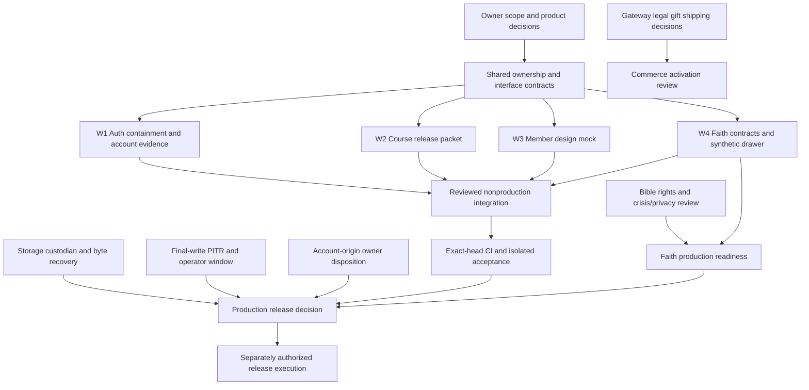

# Dependency and blocker map

## Wave 5 current result, November 1

L6 owns canonical resource DTOs and eligibility; L5 independently owns relationship, active stage, consent, owner, permissions and confirmation. A local adapter normalizes one fixture clock into ISO and epoch milliseconds and rechecks both at final confirmation. Channel is presentation only, without contact coordinates. Existing L7 merchant/product/entitlement and L8 purpose/AAL2 scopes remain separate. Real identity, consent revocation service, persistence, delivery receipts and event semantics remain future dependencies. Course exact binding, real CAPTCHA and production release gates remain open.

## Historical snapshots below

## Wave 4 current result, November 1

One coordinator-owned synthetic context is mirrored identically across four independent lanes. L6 owns canonical catalog projection; L5 consumes metadata plus independent owner/consent/share checks. Member visibility requires member:read separately from connections:share; entitled sharing remains held. L6 ISO clocks and L5/L8 epoch-millisecond fixture clocks require explicit normalization in future adapters. L6 catalog is not an L7 price/shipping/merchant/entitlement contract; L7 finance grants do not become L8 administrative authority. Real Auth/session, server permission, retention/minors, private storage/RLS, rights, merchant/legal and execution decisions remain live dependencies. Course binding and real-CAPTCHA gates remain blocked.

## Historical snapshots below

## Wave 3 current result, November 1

W3/W4 now assemble on separate integration branch without schema/live identity/provider/storage. Host owns synthetic identity, reset epoch, visit edition, local nav and feature gate; component DTOs/intents are explicit. No shared-file collision. Real Auth/session/AAL, server DTO/RLS/privacy lifecycle, photo storage, Bible rights/provider and qualified crisis review remain dependencies for live integration. Course binding remains blocked at trusted current-alias-to-immutable-deploy evidence; fresh archive hashes only if provenance requires them. L5/L6 catalog DTO proposals require one coordinator-reviewed version before consumer integration. L5–L8 source implementation remains held after automatic review.

## Historical snapshots below

## Wave 2 current result, November 1

No shared-file conflicts. W3/W4 UI prototypes progressed independently of security/release holds. W2 database280/readiness/notes ACL checks now pass independently; backend artifact/current alias binding still lacks supported immutable function attestation. An official October30 DataAPI exposure change adds a fresh authenticated REST/grant/RPC verification requirement before release, not authority to alter grants or sealed migrations. Real Auth proof/email/MFA/Sites acceptance and O02 member disposition remain blocked. W3/W4 live integration depends on visual/accessibility review, identity/permission DTOs and privacy/provider decisions. Wave3 L5/L6 share a catalog read contract, L7 depends on owner legal/payment decisions, and L8 alone owns future admin-purpose integration; coordinator reviews all cross-lane DTOs.

## Earlier wave record retained

## November 1 next-phase result

The four bounded packages completed independently despite the account-origin and release hold. No shared-file collisions occurred.

- W1 owner context is now answered “none known”; origin remains unexplained and account disposition/containment remains open. Real Turnstile proof/email/MFA/Sites compatibility remains blocked; no new keys or Auth window.
- W2 frontend parity is now verified on four routes. Backend function artifact/current binding remains a prerequisite for any credential use or new hosted acceptance. Maintenance stays ON.
- W3 isolated prototype is ready for visual/privacy review; live integration depends on approved reference, server-side DTOs, photo lifecycle and accessibility acceptance.
- W4 synthetic contracts are ready for review; real content depends on provider/version/rights decisions, trusted server policy and privacy lifecycle approval.
- Production still depends on member disposition, Storage-byte recovery/custodian, operator/final-write recovery coverage, duration authorization and a separate release window. Local prototype success closes none of those gates.

## Initialization snapshot retained for history

November 1, 2026. Solid dependencies gate integration or production, not all local work.

The graph is conceptual. It does not authorize a combined release or require all future
Faith/commerce features before a separately scoped Auth-only release. Each packet must
name its relevant gates. Auth-only schema 274 containment remains separate from course schema 280.

| Blocker | Scope | Evidence / next action | Independent work allowed |
| --- | --- | --- | --- |
| B01 Account origins/legitimacy | Security, full platform release | 181 Auth users / 181 profiles; 177 recoveries / 172 within one minute, current control state. Owner answered none known; disposition/containment decision open; retained logs incomplete | All contract/mock/inventory work with synthetic data |
| B02 Real challenge 300030 | Real CAPTCHA positive acceptance | October 19 normal Chrome Incognito and automated public diagnostic failed; root F. Password-free human second-browser diagnostic remains smallest next step | Source/contracts/UI inventory; no key requests, activation or Auth window |
| B03 Standalone Auth checkout path missing | Auth implementation handoff | d71d079 object/ref retained; recover a new persistent checkout only in scoped assignment, preserve stale registration | Read candidate via Git objects, prepare assignment |
| B04 Isolated management metadata inconsistency | New hosted acceptance access checks | get_project 404 / list omission, parent branch plus SQL healthy at 280 / paused ON. Resolve availability/binding before tests | Local course/docs/hash review |
| B05 Isolated current application identity/binding | Hosted course/Auth tests | Historical deploy `6abfd81c` ready but current site alias/name metadata differs; artifact and backend not freshly certified | Preserve deploy, no redeploy or credential entry based on stale URL |
| B06 Recovery/storage/operator | Course production release | PITR 7-day retention freshly observed, final-write window not yet established; 13 PDF independent bytes/custodian retrieval evidence missing; Dave availability/factor confirmation needed | Reconciliation, recovery plan and local metadata inventory |
| B07 Durations / lessons 11–13 | Course progression/content readiness | Authoritative 13-asset inventory exists, production population requires specific approval; missing-video states remain honest | Engine tests/mocks, no invented durations/media |
| B08 Visual source/approved component contracts | Visible dashboard changes | Preserve both sites; no final new dashboard mock supplied; course standard available in docs | Existing-token inventory, review-only synthetic mock after authorization |
| B09 Bible translation rights/defaults | Real Scripture ingestion/display/cache/export | Provider/version/license/attribution/locale/rights not selected | Synthetic placeholders/provider interfaces/reference parser |
| B10 Faith privacy/crisis policy | Sensitive persistence/sharing and crisis release | Owner policy/reviewer, minors/localization/lifecycle missing | Data-minimized domain contracts and nonpersistent mock |
| B11 Payment/legal/book/shipping policy | Commerce and gifts only | Provider preference is not decision, activations prohibited | Provider-neutral ledger/readiness and review docs |
| B12 CI coverage for future integration target | Nonproduction PR integration | Current PR workflow targets only main; codex/integration-target PRs would not run automatically | Plan reviewed workflow change before first integration PR; local configured checks |
| B13 Provider/runtime maintenance review | Future release/security review | Provider overall summary says operational, page updated October 21; production version 17.6.1.166 and current minor-upgrade/TLS notices | Document impact separately, no automatic upgrade or release bypass |

Shared-file locks in SHARED_COMPONENT_API_OWNERSHIP.md are mandatory for future work.
A lane may not resolve a dependency by editing the other lane's owned files. Escalate a
small interface request to coordinator; freeze affected integration until both owners
review it. Documentation-only lanes continue while production gates stay closed.
